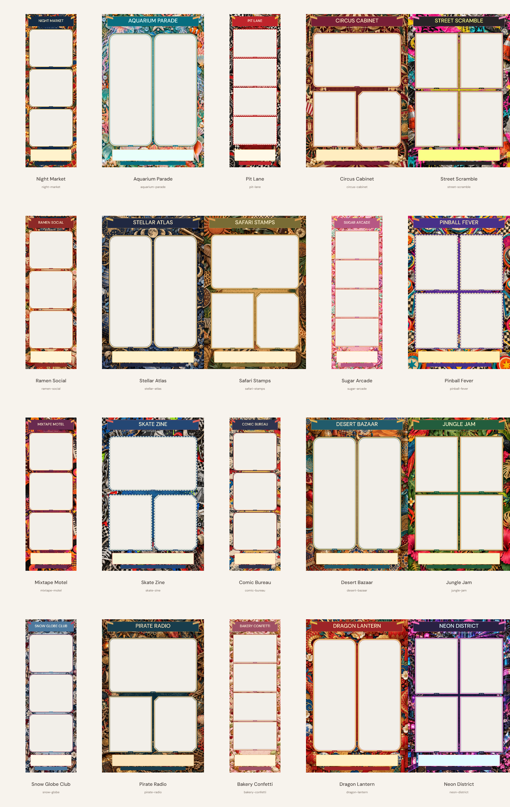

# Fotbooth

Photobooth web berbahasa Indonesia dengan **80 frame**, kamera, unggah foto, editor crop, **12 pilihan efek foto** termasuk Original, **16 efek AR** dan unduhan PNG/JPEG. Mode solo memproses foto dan caption secara lokal di browser. Mode room membagikan kamera dan foto kepada peserta melalui koneksi langsung atau relay sementara, tanpa penyimpanan foto server.

Situs publik: [fotbooth.pages.dev](https://fotbooth.pages.dev).

Alur kamera dengan pemeriksaan tiap foto sudah publik sejak **13 Oktober 2026**, deployment [723ce602](https://723ce602.fotbooth.pages.dev). Kamera menjadi pilihan utama; setelah cekrek, hasil ditampilkan sampai kamu memilih **Pakai foto & lanjut** atau **Ambil ulang**. [Bukti rilis kamera](docs/qa/camera-review-release-20261013.json).

## Foto Bareng Online

Foto Bareng Online dengan koleksi frame diterbitkan pada **13 Oktober 2026** dan tetap tersedia di [situs utama](https://fotbooth.pages.dev). Deployment rilis room sebelumnya [b88cf128](https://b88cf128.fotbooth.pages.dev) menjadi pilihan rollback untuk pembaruan kamera; [pratinjau room](https://e2e8f932.fotbooth.pages.dev) tetap tersedia. [Panduan room](docs/ONLINE-ROOMS.md), [bukti pemeriksaan rilis room](docs/qa/online-room-catalog-release-20261013.json).

Fitur room privat menghubungkan dua kamera, memisahkan latar secara lokal, lalu menempatkan kedua peserta berdampingan dalam frame pilihan. Seluruh **80 frame koleksi yang sudah tersedia** dapat dipakai, bersama tiga frame khusus room: Satu Tempat, Surat Rindu, dan Night Date. Frame dengan 2–4 slot mengambil 2–4 pose bersama; setiap slot berisi foto berdua yang baru. Pembuat room membagikan undangan, keduanya menandai siap sekali, lalu hitung mundur setiap pose berlangsung otomatis. Tiga latar bersama tersedia.

Room memakai coordinator online dan WebRTC, dengan relay sementara saat sambungan langsung tidak tersedia. Host menghasilkan PNG sekali dan mengirim file yang sama kepada peserta lainnya. Hasil selesai tetap dapat diunduh ketika pasangan keluar atau koneksi terputus; foto ulang menghapus hasil lama dan dapat diteruskan setelah reconnect. Kamera/foto dibagikan kepada peserta room; server tidak menyimpan foto. Mode solo tetap lokal. Lihat [cara menjalankan, privasi dan batas koneksi](docs/ONLINE-ROOMS.md).

Pemeriksaan ulang situs produksi: **16 tes room lulus, 12 skip terkait fixture WebKit, tanpa gagal/flaky**; unduhan empat pose identik melalui koneksi langsung maupun relay, termasuk foto ulang dan pemulihan koneksi. Empat smoke HTTPS solo/AR Chromium dan WebKit juga lulus. Seluruh 729 file yang dilayani produksi cocok dengan kandidat build; 146 unit test, TypeScript dan build lulus. [Audit kelanjutan](docs/qa/online-room-continuation-audit-20261013.json). Kamera dan HP fisik belum tercakup dalam bukti otomatis.

Dua puluh **Festival Editions** memperluas 60 frame sebelumnya: Night Market, Aquarium Parade, Pit Lane, Circus Cabinet, Street Scramble, Ramen Social, Stellar Atlas, Safari Stamps, Sugar Arcade, Pinball Fever, Mixtape Motel, Skate Zine, Comic Bureau, Desert Bazaar, Jungle Jam, Snow Globe Club, Pirate Radio, Bakery Confetti, Dragon Lantern, dan Neon District. Tema memakai 20 material ImageGen terpisah, dengan kolase kertas yang ramai, rim dan label native serta layout strip/kartu untuk 2–4 foto. Frame lama dan aset versinya tetap tersedia.

Galeri selalu menampilkan area foto netral tanpa contoh orang. Pencarian tersedia berdasarkan nama/deskripsi, dengan filter kategori, koleksi, format dan jumlah foto. Pilih koleksi **Festival Editions** untuk melihat semua tambahan.

## Kamera

**Buka kamera** menjadi pilihan utama setelah memilih frame; unggah foto tetap tersedia. Setelah mengambil satu foto, periksa hasilnya di layar: pilih **Pakai foto & lanjut** untuk mengisi slot dan menuju foto berikutnya, atau **Ambil ulang** untuk mencoba lagi. Foto yang belum diterima tidak masuk sesi.

Setiap slot yang terisi menampilkan thumbnail. Klik thumbnail untuk memeriksa hasil yang sudah disimpan, lalu lanjutkan atau ambil ulang slot itu. Foto terakhir yang diterima membuka editor. **Ambil rangkaian** tetap tersedia sebagai pilihan otomatis yang mengisi slot tanpa pemeriksaan per foto.

## Efek foto

Original, Hitam putih, Sepia, Vintage, Warm, Cool, Vivid, Soft, Noir, Faded, Rose dan Cinema. Pilih sebelum memotret untuk melihat efek pada kamera, atau sesudahnya per slot di editor. Intensitas 0–100%. Efek mengikuti foto saat ditukar atau frame diganti, mendukung undo/redo, dan ikut dirender ke PNG/JPEG. Foto asli tetap tersedia selama sesi, sehingga efek dapat dihapus tanpa mengambil foto ulang.

Preview kamera memakai CSS; hasil komposisi memakai operasi piksel pada permukaan foto terpisah agar bekerja di Chromium/WebKit tanpa bergantung pada dukungan canvas.filter. Dekorasi, caption dan area kosong tidak ikut diberi efek.

## AR playground

Pilih AR di layar kamera: Kitty Club, Bunny Pop, Teddy Mood, Disco Glasses, Golden Crown, Ribbon Crush, Party Time, Peach Freckles, Heart Orbit, Butterfly Halo, Smile Confetti, Comic Boom, Peach Studio, Aqua World, Neon City dan Neon Silhouette. Aksesori mengikuti posisi/sudut hingga dua wajah; reaksi menggunakan ekspresi senyum/mulut. Tiga latar virtual dan siluet memakai mask orang.

Foto asli dan snapshot AR disimpan terpisah. Checkbox **Tampilkan AR pada foto ini** di editor memulihkan foto asli; mendukung undo/redo. AR mengikuti mirror, crop dan putaran serta masuk ke hasil PNG/JPEG bersama efek warna. Animasi dibekukan saat shutter pada frame foto yang sama. Sisakan ruang di atas kepala agar aksesori masuk dalam panduan slot.

Model/WASM dimuat dari situs sendiri hanya setelah AR dipilih. Inferensi 640px, pratinjau maksimal 10Hz; worker di browser yang mendukung WebGL OffscreenCanvas, jalur utama terbatas di Safari lama. Keluar kamera, tab tersembunyi atau Tanpa AR menghentikan runtime. Jika model gagal, coba ulang atau lanjut memotret tanpa AR. Lihat [rincian dan batas AR](docs/AR-OPTIONS.md), [provenance model](artwork/provenance/ar-runtime-20261007.json).

## Jalankan

Gunakan Node 24.14.1 sesuai .node-version. Jalankan npm ci lalu npm run dev.

Buka http://127.0.0.1:5173/. Kamera memerlukan localhost atau HTTPS. Unggah tersedia ketika kamera ditolak.

## Pemeriksaan

Jalankan npm run check, npx playwright install chromium webkit dan npm run test:e2e. Playwright menyalakan Vite dan coordinator room lokal, lalu menghentikan server yang dimulainya setelah tes selesai.

Unit tests memeriksa katalog, geometri, file foto, sesi, history, crop, teks, efek dan ekspor. Suite browser memeriksa seluruh thumbnail/layer, interior foto, PNG/JPEG standar/ringan, pencarian, kamera sintetis, editor, efek, AR dengan model nyata, keyboard, viewport dan privasi jaringan. Pengujian Chromium/WebKit otomatis belum menggantikan HP dan kamera fisik.

Suite lengkap setelah perbaikan coordinator: **120 lulus, 24 skip, 0 gagal/flaky** pada Chromium/WebKit. Kedua server pengujian berhenti setelah run. [Laporan lengkap](docs/qa/online-room-continuation-local-20261013.json).

## Cloudflare Pages

Repo public: [alifikri25/fotbooth](https://github.com/alifikri25/fotbooth). Project fotbooth memakai Direct Upload, production branch main, build npm run build, output dist. Push GitHub belum otomatis menerbitkan revisi.

Setelah pemeriksaan lokal, jalankan npm run deploy:preview, periksa preview HTTPS, lalu npm run deploy:cloudflare.

[Panduan Cloudflare](docs/DEPLOY-CLOUDFLARE.md), [rilis dan rollback](docs/RELEASE.md). Jangan commit .env, token, atau konfigurasi login.

## Artwork

[Registry 80 frame](docs/FRAME-REGISTRY.md), [provenance artwork](artwork/README.md), [board Festival Editions](docs/qa/festival-design-board.png), [contact sheet](docs/qa/frame-contact-sheet.png).

Regenerasi: npm run assets:build, npm run qa:frames dengan dev server aktif, lalu node scripts/write-registry.mjs.

Material signature sebelumnya tetap ada. Thumbnail lama dan paket v1/v2/v3 dipertahankan. Source manifest berada di src/frames/manifests; source definisi baru di src/frames/maximalist.ts. Semua bahan web berada di repository dan tidak memerlukan panggilan ImageGen saat runtime.

## Batas dukungan

Input: JPG, PNG, WebP diam; maksimal 20 MB, 24 MP per foto dan 8 foto per sesi. Caption maksimal 40 grapheme; history 30 langkah. HEIC, SVG upload, animasi dan URL foto bebas tidak diterima. Akun, draft tersimpan, share dan frame builder belum tersedia. Menutup atau memuat ulang tab mengakhiri sesi.

Strip standar: 1200×3600; kartu: 1800×2700. Ukuran ringan tepat setengah.
